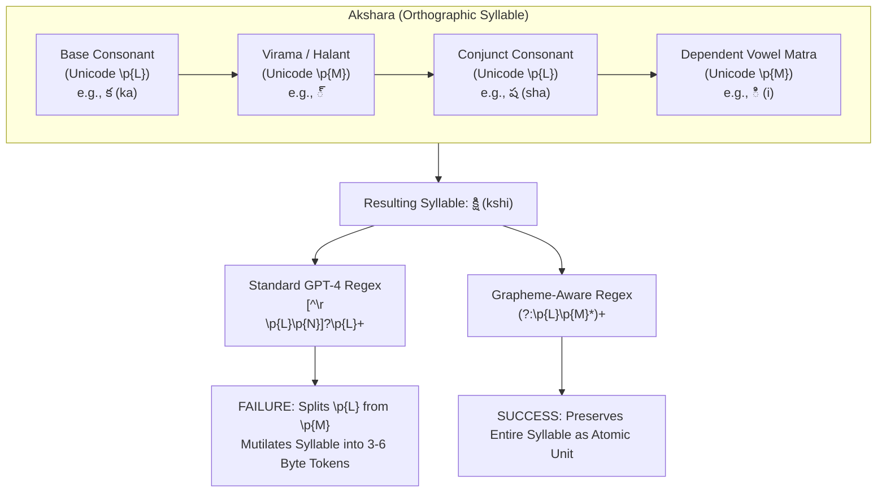
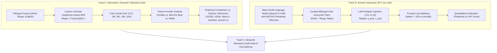

# PROJECT_3_SPECIFICATION_AND_GOALS.md
# UMC301 Project 3: Hindi & Telugu Token Fertility Pareto Audit & Domain LoRA SFT

**Course:** Applied Data Science and Artificial Intelligence (UMC301)  
**Institution:** Indian Institute of Science (IISc), Computational and Data Sciences (CDS)  
**Domain:** Computational Linguistics, Multilingual Token Economics, Information Theory & Parameter-Efficient Fine-Tuning (PEFT)  
**Textbook Alignment:** Chapter 09 (*Large Language Models: Pretraining*), Section 9.3 (*The Pretraining Data Pipeline & Multilingual Tokenization*), Table 9.3 (*Practical Pitfalls in Tokenization*), and Chapter 08 (*Transformer Architecture & PEFT*)  
**Target:** A+ Grade Defense via Rigorous Spec-Driven Engineering & First-Principles Derivations  

---

## 1. Executive Summary & Core Motivation

Modern commercial and open-weights Large Language Models (LLMs)—including GPT-4o (`o200k_base`), LLaMA-3 (`128k`), and Claude 3.5 Sonnet—are capable of generating fluent Hindi and Telugu. This visual fluency masks a severe underlying architectural failure mode: **catastrophic tokenization disparity**, referred to in computational linguistics as the **"Language Tax"** (Petrov et al., NeurIPS 2023; Sarvam AI, 2024).

Because web-scale tokenizers are trained on corpora where English and Latin-script code constitute >85% of the data, the Byte-Pair Encoding (BPE) merge priority is disproportionately captured by English words and subwords. In contrast, morphologically rich and syllabic Indian languages (such as Indo-Aryan **Hindi** and agglutinative Dravidian **Telugu**) are heavily fragmented into sub-character byte chunks (`<0xE0><0xA4>...`).

### The Real-World Impact: The Three Penalties
1. **Context Window Starvation:** A model with an 8,192-token context window can ingest ~6,500 English words, but fewer than ~1,600 Telugu words before context truncation occurs.
2. **Inference Latency & Energy Amplification:** Autoregressive decoding requires one full forward pass per token ($O(N)$ sequential operations). Generating a 100-word response in Telugu requires 3× to 5× more sequential forward passes than in English, linearly multiplying user latency and inference compute energy.
3. **Monetary Discrimination:** Commercial APIs bill customers per token. Indian enterprises and developers deploying citizen services or healthcare systems in Indic languages pay **300% to 500% more money** for the identical semantic information compared to English deployments.

---

## 2. Linguistic Foundations & The "Unicode Trap"

Understanding why standard tokenizers fail on Indian languages requires analyzing the structural writing systems and character encoding standards of Devanagari and Telugu scripts.



### 2.1 The Akshara (Alphasyllabary) Orthography
Both Devanagari (Hindi) and Telugu script belong to the Brahmic family of **abugidas (alphasyllabaries)**:
* Unlike Latin alphabets where vowels and consonants are independent letters written sequentially, Indian scripts organize text into **Aksharas** (orthographic syllabic units).
* An Akshara consists of an inherent base consonant, optional consonant clusters linked via a **virama/halant** (Telugu `్` `\u0C4D`, Devanagari `्` `\u094D`), and optional dependent vowel signs (**matras**), anusvara, or visarga:
  $$\text{Akshara} = C_1 + (\text{Virama} + C_2)^* + \text{Matra} + \text{Anusvara}$$

### 2.2 The Unicode Classification Pitfall (`\p{L}` vs. `\p{M}`)
* In the Unicode Standard:
  * Independent consonants are classified under General Category **`\p{L}`** (Letters).
  * Dependent matras and viramas are classified under General Category **`\p{M}`** (Combining Marks).
* Standard industrial pre-tokenization regular expressions (such as OpenAI's `cl100k_base`):
  ```regex
  (?i:'s|'t|'re|'ve|'m|'ll|'d)|[^\r\n\p{L}\p{N}]?\p{L}+|\p{N}{1,3}| ?[^\s\p{L}\p{N}]+[\r\n]*|\s*[\r\n]+|\s+(?!\S)|\s+
  ```
  * Note the chunking pattern `[^\r\n\p{L}\p{N}]?\p{L}+`. It explicitly matches runs of **letters only (`\p{L}`)**, excluding combining marks (`\p{M}`).
  * Consequently, the pre-tokenizer **slices through the middle of syllables**, separating vowel matras from base consonants into separate chunks.
  * Because chunks can never be merged across chunk boundaries in BPE, the combining marks are stranded as isolated tokens or fall back to raw UTF-8 byte sequences.

### 2.3 Telugu Agglutinative Morphology
* Telugu is an **agglutinative Dravidian language**: complex grammatical relations (case markers, plural suffixes, postpositions, tense markers, subject-verb agreement) are suffixed directly onto root nouns and verbs.
* Example: *రామునితో* (*ramunitho* = "with Rama"), *చేయలేకపోయాను* (*cheyalekapoyanu* = "I was unable to do it").
* A naive subword tokenizer without sufficient language-specific merge rules will split a single agglutinated word into 6 to 10 subwords, whereas an English equivalent ("with Rama") takes 2 tokens.

---

## 3. Decoupled Two-Track Architecture

A foundational contribution of this project is avoiding the fatal design flaw common in naive NLP student projects: **The Embedding Misalignment Trap**.

> [!WARNING]
> **The Embedding Misalignment Trap:**  
> If an engineer trains a custom Indic tokenizer from scratch and attempts to plug it into a frozen pretrained LLM (e.g., LLaMA-3 or Qwen2.5), the model outputs gibberish. The base model's embedding matrix $W_{\text{embed}} \in \mathbb{R}^{|V| \times d}$ associates index $i$ with a specific token learned during pretraining. Changing the tokenizer scrambles token indices, requiring hundreds of billions of tokens of expensive continued pretraining to realign the embedding weights.

To maintain strict academic rigor and zero weight misalignment, Project 3 is decoupled into two self-contained, mathematically sound tracks:



---

## 4. Track A: Information-Theoretic Tokenizer Audit Specifications

### 4.1 Grapheme-Preserving Pre-Tokenizer Engine
* **Regex Specification:**
  ```python
  INDIC_GRAPHEME_PATTERN = r"""(?i:'s|'t|'re|'ve|'m|'ll|'d)
  | (?:\p{L}\p{M}*)+
  | \p{N}{1,3}
  | [^\s\p{L}\p{N}]+[\r\n]*
  | \s*[\r\n]+
  | \s+(?!\S)
  | \s+
  """
  ```
* **Invariant:** Every Akshara consisting of a letter $\p{L}$ and subsequent combining marks $\p{M}^*$ remains in a single contiguous pre-tokenization chunk. No merge rule is ever starved of its vowel attachment.

### 4.2 Training the Vocabulary Grid
* Implemented via Hugging Face `tokenizers` library using `ByteLevelBPETrainer`.
* Target vocabulary sizes:
  $$|V| \in \{4\,096, \; 8\,192, \; 16\,384, \; 32\,768\}$$
* Base alphabet: 256 byte tokens (guaranteeing 0% Out-of-Vocabulary rate) + special tokens (`<unk>`, `<s>`, `</s>`, `<pad>`).

### 4.3 Mathematical Metrics

#### Metric 1: Token Fertility ($\mathcal{F}$)
The average number of subword tokens produced per word in language $L$:
$$\mathcal{F}(L) = \frac{\sum_{s \in \mathcal{S}_L} \text{len}(\text{tokenize}(s))}{\sum_{s \in \mathcal{S}_L} \text{word\_count}(s)}$$
* Target Parity Ratio: $\frac{\mathcal{F}(\text{Telugu})}{\mathcal{F}(\text{English})} \to 1.0$ (Ideal parity).

#### Metric 2: Bits-Per-Byte (BPB)
The information-theoretic compression rate under a subword language model / unigram distribution:
$$\text{BPB}(s) = \frac{\sum_{i=1}^{N} -\log_2 P(t_i)}{\text{Total UTF-8 Bytes of } s}$$
Where $P(t_i) = \frac{\text{count}(t_i)}{\sum_j \text{count}(t_j)}$ is the empirical token probability over the reference corpus.

#### Metric 3: Embedding Table Memory Footprint ($\mathcal{M}_{\text{embed}}$)
$$\mathcal{M}_{\text{embed}} = |V| \times d_{\text{model}} \times b_{\text{param}} \quad \text{bytes}$$
For a typical $d_{\text{model}} = 2048$ with 16-bit precision ($b_{\text{param}} = 2$ bytes):
* $|V| = 4\text{K} \implies 16.38\text{ MB}$
* $|V| = 32\text{K} \implies 131.07\text{ MB}$
* $|V| = 128\text{K} \implies 524.29\text{ MB}$
* $|V| = 200\text{K} \implies 819.20\text{ MB}$

### 4.4 The Pareto Frontier Analysis
* We plot **Token Fertility ($\mathcal{F}$)** and **BPB** on the vertical axis against **Embedding Memory ($\mathcal{M}$)** on the horizontal axis across all $|V|$.
* We compute the marginal compression derivative $\frac{\Delta \mathcal{F}}{\Delta |V|}$ to pinpoint the exact "knee of the curve" (the point beyond which allocating additional vocabulary yields negligible compression gains while wasting GPU memory).

### 4.5 Named Industry Benchmark Suite
We evaluate an identical held-out test split of parallel sentences across:
1. `cl100k_base` (OpenAI GPT-4, TikToken)
2. `o200k_base` (OpenAI GPT-4o, TikToken)
3. `meta-llama/Meta-Llama-3-8B` (HuggingFace Transformers, 128k vocab)
4. `ai4bharat/indic-bert` (IndicBERT WordPiece)
5. `sarvamai/sarvam-1` (Sarvam AI Indic-optimized tokenizer)
6. **Our Custom Grapheme-Aware BPE** ($|V| = 32\text{K}$)

---

## 5. Track B: Domain Instruction SFT via LoRA Specifications

### 5.1 Base Model Selection
* **Model:** `Qwen/Qwen2.5-0.5B` (or `HuggingFaceTB/SmolLM-135M`)
* **Rationale:** Compact parameter footprint enables full local execution or rapid Google Colab T4 training; strong native multilingual foundation; clean open weights.
* **Tokenizer:** Uses the model's **native pre-trained tokenizer** to preserve 100% embedding representation fidelity.

### 5.2 Bilingual Instruction Dataset Curation
* Curated subset of bilingual instruction-following pairs (Hindi and Telugu):
  * Source: IndicAlign / Bactrian-X Indic subsets / Alpaca-Indic.
  * Task categories: Summarization, Q&A, Translation, and General Reasoning.
  * Size: 2,000–5,000 high-quality paired examples.

### 5.3 Prompt-Loss Masking Protocol
To prevent the model from learning to predict the user's prompt (which wastes gradient capacity on input formatting), we implement strict label masking:
$$\mathcal{L}_{\text{SFT}} = -\frac{1}{|\mathcal{Y}|} \sum_{t \in \mathcal{Y}} \log P(y_t \mid x, y_{<t})$$
* In PyTorch tensor implementation:
  $$\text{labels}[i] = \begin{cases} -100 & \text{if token } i \text{ belongs to prompt } x \\ \text{input\_ids}[i] & \text{if token } i \text{ belongs to response } y \end{cases}$$

### 5.4 LoRA Formulation & Mathematical Backpropagation
Low-Rank Adaptation freezes base weights $W_0 \in \mathbb{R}^{d \times k}$ and introduces trainable low-rank matrices $B \in \mathbb{R}^{d \times r}$ and $A \in \mathbb{R}^{r \times k}$ ($r \ll \min(d, k)$):
$$W = W_0 + \Delta W = W_0 + \frac{\alpha}{r} B A$$
* Forward Pass:
  $$h = W x = W_0 x + \frac{\alpha}{r} B (A x)$$
* Target Projections: `q_proj` and `v_proj` inside each self-attention block.
* Hyperparameters:
  * Rank $r = 8$
  * Scaling factor $\alpha = 16$ (scaling multiplier $\frac{\alpha}{r} = 2.0$)
  * LoRA Dropout = $0.05$
  * Trainable parameter fraction: $< 0.8\%$ of total model parameters.

#### Backpropagation Derivation (Whiteboard Ready):
Let $G = \frac{\partial \mathcal{L}}{\partial h} \in \mathbb{R}^{B \times d}$ be the upstream gradient of the loss with respect to layer output $h$:
$$\frac{\partial \mathcal{L}}{\partial A} = \frac{\alpha}{r} B^T G x^T$$
$$\frac{\partial \mathcal{L}}{\partial B} = \frac{\alpha}{r} G (A x)^T$$
$$\frac{\partial \mathcal{L}}{\partial x} = \left( W_0^T + \frac{\alpha}{r} A^T B^T \right) G$$
During backward propagation, $W_0$ is completely frozen and requires no optimizer state or gradient accumulation.

### 5.5 Quantitative Evaluation Protocol
1. **Validation Loss & Perplexity:**
   $$\text{Perplexity} = \exp(\mathcal{L}_{\text{val}})$$
2. **Character n-gram F-score (chrF):**
   * Standard BLEU relies on exact word matches, failing on agglutinative languages where a single altered case suffix flags an entire word as incorrect.
   * **chrF** evaluates character n-gram precision and recall ($n \in [1, 6]$), capturing whether prefixes, roots, and vowel matras were accurately synthesized.

---

## 6. Track C: Interactive Audit Suite & Viva Defense

### 6.1 Streamlit Dashboard Architecture
* **Tab 1: Live Tokenizer & Syllable Inspector**
  * Text area accepting arbitrary Hindi, Telugu, or English inputs.
  * Side-by-side color-coded subword token chips for `cl100k`, `o200k`, `llama-3`, and our `custom-BPE`.
  * Visual indicator flagging whether matras were broken or preserved.
* **Tab 2: Language Tax & API Cost Calculator**
  * Inputs: Document length (words) + Expected queries/month.
  * Outputs: Comparative token consumption, API bill in USD/INR across tokenizers, and latency multiplier.
* **Tab 3: Pareto Frontier Explorer**
  * Interactive Plotly charts of Vocab Size vs. Fertility vs. RAM.
* **Tab 4: LoRA Inference Arena**
  * Side-by-side generation: Base SLM vs. LoRA-adapted SLM on unseen Hindi and Telugu prompts.

---

## 7. Directory Structure

```
Project3_Indic_Tokenizer_LoRA_SFT/
├── PROJECT_3_SPECIFICATION_AND_GOALS.md  # Complete project specification
├── data/
│   ├── raw/                              # IndicCorp / Flores excerpts (Hindi, Telugu, English)
│   ├── processed/                        # NFC-normalized, cleaned tokenization corpora
│   └── instructions/                     # Bilingual instruction pairs (train/val/test splits)
├── src/
│   ├── __init__.py
│   ├── tokenizer/
│   │   ├── __init__.py
│   │   ├── unicode_regex.py              # Custom grapheme-preserving pre-tokenizer regex
│   │   ├── trainer.py                    # HuggingFace tokenizers ByteLevelBPE training loop
│   │   ├── fertility.py                  # Token fertility calculator (tokens/word)
│   │   └── bpb.py                        # Bits-Per-Byte computation engine
│   ├── audit/
│   │   ├── __init__.py
│   │   ├── benchmark.py                  # Comparative audit vs named industry tokenizers
│   │   ├── pareto.py                     # Pareto frontier generator (compression vs RAM)
│   │   └── language_tax.py               # Latency & API cost disparity calculator
│   └── sft/
│       ├── __init__.py
│       ├── dataset.py                    # PyTorch Dataset with prompt-loss masking (-100)
│       ├── lora_model.py                 # PEFT LoRA injection on Qwen2.5-0.5B
│       ├── train.py                      # Mixed-precision SFT training loop
│       └── evaluate.py                   # Perplexity & chrF evaluation engine
├── tests/
│   ├── test_grapheme_regex.py            # Verifies consonant-matra cluster integrity
│   ├── test_metrics.py                   # Unit tests for fertility, BPB, and compression math
│   └── test_lora_sft.py                  # Asserts parameter freezing and adapter forward pass
├── app/
│   └── app.py                            # Streamlit interactive audit suite & playground
├── artifacts/                            # Saved Pareto plots, benchmark tables & LoRA weights
└── README.md                             # Quickstart guide and viva defense summary
```

---

## 8. Viva Defense First-Principles Checklist

To secure an **A+ grade**, you must be prepared to answer and derive the following on a whiteboard:

1. **Information-Theoretic Compression:**
   * Derive Bits-Per-Byte from Shannon's source coding theorem:
     $$\mathbb{E}[L] \ge H(X) = -\sum p_i \log_2 p_i$$
2. **The Linguistic Failure Mode:**
   * Explain Unicode Category `\p{L}` vs. `\p{M}` and demonstrate why GPT-4's pre-tokenization regex mutilates Telugu Aksharas.
3. **The Pareto Frontier Trade-Off:**
   * Explain why $|V| = 256\text{K}$ is not a panacea: explain how embedding table parameter growth ($|V| \times d_{\text{model}}$) cannibalizes GPU memory bandwidth during decoding.
4. **The Embedding Misalignment Catastrophe:**
   * Explain why a custom tokenizer cannot be grafted directly onto a frozen base LLM without retraining the embedding layer.
5. **LoRA Forward & Backward Math:**
   * Write down the low-rank forward pass $h = W_0 x + \frac{\alpha}{r}BAx$ and derive the gradients $\frac{\partial \mathcal{L}}{\partial A}$ and $\frac{\partial \mathcal{L}}{\partial B}$.
